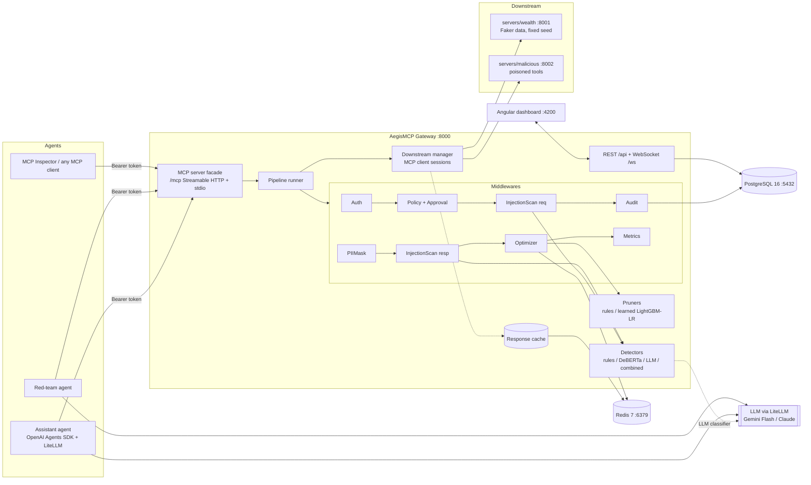
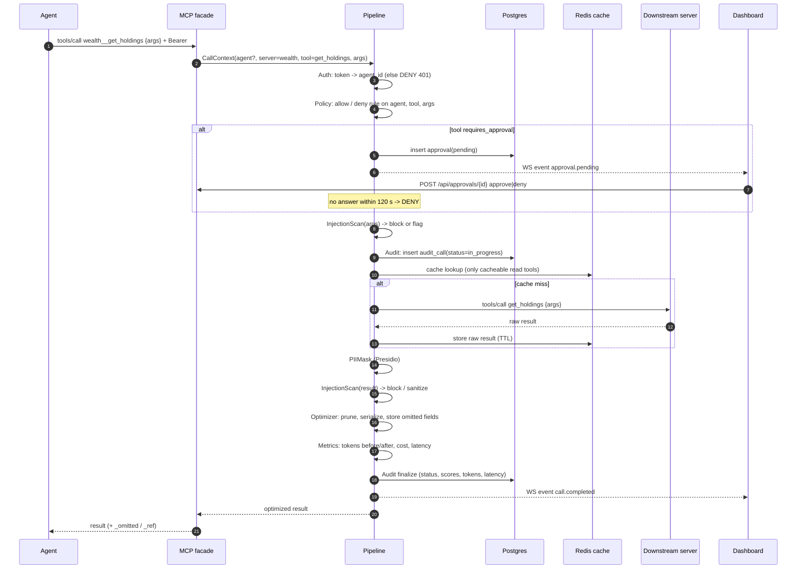
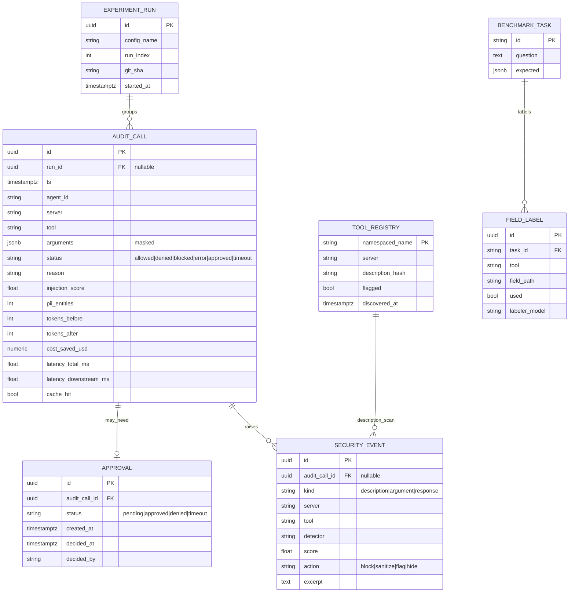
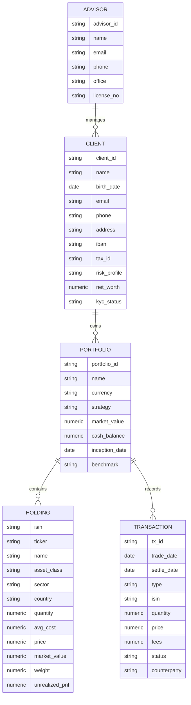

# AegisMCP Architecture

Status: Phase 0 draft, waiting for approval. Library APIs named here are the *planned* ones.
Each one is checked against the installed version (site-packages) before it is used.

## 1. Big picture

AegisMCP is a reverse proxy for the Model Context Protocol:

- **Northbound** (towards agents), it is an MCP **server**: Streamable HTTP at `:8000/mcp`, plus stdio.
- **Southbound** (towards tools), it is an MCP **client** with one session per downstream server.
- **Between the two**, every `tools/list` and `tools/call` goes through a middleware pipeline
  that is set in config (security → audit → privacy → optimization → metrics).
- **On the side**, a FastAPI app (`/api/*` REST + `/ws` WebSocket) serves the dashboard and the
  approval queue. It runs in the same process and on the same port (8000) as the MCP endpoint.

### 1.1 Component diagram



### 1.2 Request/response sequence (one `tools/call`)



`tools/list` uses the same pipeline with the `on_list_tools` hook. Downstream tool lists are merged
and renamed to `<server>__<tool>`. Descriptions are scanned for injections at discovery (startup and
refresh), and flagged tools are hidden or sanitized per config. The gateway also adds its own
`gateway__fetch_omitted` tool.

## 2. Key design choices (details and alternatives in DECISIONS.md)

1. **Middleware interface**: there is one `Middleware` base class with optional hooks
   `on_list_tools`, `on_request`, `on_response`, and `on_complete` (`on_complete` always runs, even after a deny).
   Config has **two ordered lists**, `pipeline.request` and `pipeline.response`. Experiment (6),
   filter→compress vs compress→filter, is then just a reordered list. A classic "onion" design would
   force the response order to be the reverse of the request order, so it can't run that experiment.
2. **Short-circuit**: a middleware stops a call by raising `PipelineDenied(reason, code)`. The runner
   turns it into an MCP tool error (`isError=true`) that the agent can read. `on_complete` hooks still
   run, so denied calls are audited too.
3. **Cache at the downstream boundary**: the cache stores the RAW downstream result. A cache hit
   still goes through PII masking, injection scanning, and question-dependent pruning. Tools with
   side effects (`transfer_funds`) are never cached (`cacheable: false`).
4. **Question context for learned pruning**: an MCP `tools/call` carries no user question. The
   assistant sends it in the request `_meta` (`aegis/question`), with a fallback to the HTTP header
   `X-Aegis-Question`. When it is missing, the learned pruner falls back to rule-based pruning.
   This must be verified in Phase 4/7 (open decision).
5. **Auth = API keys** (one per agent, stored in `.env`). Config only holds the name of the env
   variable. Comparison uses `hmac.compare_digest`. JWT is not needed: there is one issuer and no
   third-party identity. Over stdio, the local launching process is trusted and its agent id comes
   from `--agent`.
6. **Token counting**: tiktoken runs in-path (fast, so it doesn't add latency). The provider's official
   count-tokens API is used **offline** in evaluation for the reported numbers.
7. **Approval waits**: an in-memory `asyncio.Future` per pending approval, plus a Postgres row for
   persistence and display. This works for a single gateway instance; several instances would need
   Redis pub/sub, which is documented as a limitation.
8. **Evidence recovery store = Redis**: `omitted:<ref>` is stored with a TTL. Data is short-lived and
   per call, and Postgres would grow without bound.
9. **Wealth data is generated in memory** at server startup (Faker, seed 42). It is deterministic and
   needs no extra database, so it is easy to reproduce.
10. **Injection detector interface**: `Detector.score(text) -> Detection(score, label, latency_ms)`.
    Long texts are split into chunks (512 model tokens), and the call's score is the max over chunks.
    Response JSON is scanned per string value, which is cheaper and gives more precise sanitization.

## 3. Data model

### 3.1 Gateway database (PostgreSQL)



Agents and policies live in YAML (they are versioned with the code), not in the database.

### 3.2 Wealth demo domain (in memory, Faker seed 42)



Each tool returns about 20–40 fields per record and nested objects, so pruning has a real effect.

## 4. Folder structure

```
aegis-mcp/
├── CLAUDE.md  README.md  pyproject.toml  uv.lock  .env.example  .gitignore
├── .pre-commit-config.yaml  docker-compose.yml  Dockerfile
├── .github/workflows/ci.yml
├── config/
│   ├── gateway.yaml          # servers, pipeline order, toggles, thresholds, prices
│   ├── policies.yaml         # agent/tool/argument rules, requires_approval
│   ├── pruning_rules.yaml    # per-tool fields to keep
│   └── profiles/             # evaluation configs (no_gateway, security_only, ...)
├── servers/
│   ├── wealth/               # server.py, data.py (Faker), models.py
│   └── malicious/            # server.py, payloads.py
├── gateway/
│   ├── __main__.py  app.py  config.py  namespacing.py  tokens.py  llm.py
│   ├── mcp_facade.py         # northbound MCP server (HTTP + stdio)
│   ├── downstream.py         # southbound MCP client sessions + cache
│   ├── pipeline/             # context.py, base.py, runner.py, errors.py
│   ├── middlewares/          # auth, policy, approval, injection, pii, audit, metrics
│   │   └── optimizer/        # rules, learned, serialize, evidence
│   ├── detectors/            # base, rules, transformer, llm, combined
│   ├── db/                   # models.py, session.py, migrations/ (Alembic)
│   └── api/                  # rest.py, ws.py
├── ml/
│   ├── injection/            # datasets.py, synth.py, split.py, train.py, evaluate.py
│   │   └── notebooks/train_deberta_colab.ipynb
│   ├── pruning/              # label.py, features.py, train.py, evaluate.py
│   ├── data/                 # gitignored (downloaded / generated)
│   └── artifacts/            # small models committed; >50 MB gitignored + download script
├── agents/
│   ├── assistant/            # wealth-advisor agent
│   └── redteam/              # attack variant generator
├── evaluation/
│   ├── tasks/  attacks/  benign/   # benchmark definitions (YAML/JSONL)
│   ├── runner.py  report.py  metrics.py
│   ├── results/              # CSV + PNG
│   └── REPORT.md             # generated
├── dashboard/                # Angular app
├── tests/
│   ├── unit/                 # mirrors packages
│   └── integration/          # real Postgres/Redis via docker compose
└── docs/  ARCHITECTURE.md  DECISIONS.md  DATASETS.md  PROGRESS.md  HANDOFF.md  PROJECT_SPEC.md
```

There is one uv project (one `pyproject.toml`) with dependency groups: `dev` (tools), `ml` (training
only), and `agents`. The gateway image installs only the runtime it needs. PyTorch comes from the
CPU-only wheel index to keep the image small.

## 5. Config sketch (`config/gateway.yaml`, illustrative)

```yaml
servers:
  wealth:    {transport: streamable_http, url: http://localhost:8001/mcp}
  malicious: {transport: streamable_http, url: http://localhost:8002/mcp, enabled: false}
agents:
  assistant: {token_env: AGENT_TOKEN_ASSISTANT}
pipeline:
  request:  [auth, policy, injection_scan, audit]
  response: [pii_mask, injection_scan, optimizer, metrics]
middlewares:
  injection_scan: {enabled: true, detector: rules, threshold: 0.5, on_response: sanitize}
  pii_mask: {enabled: true, entities: [IBAN_CODE, EMAIL_ADDRESS, PHONE_NUMBER, CREDIT_CARD]}
  optimizer:
    pruning: rules          # off | rules | learned
    serialization: json     # json | compact_table
    cache: {enabled: true, ttl_s: 300}
    evidence_recovery: true
prices: {gemini-flash: {input_per_mtok: <from provider page>}}
approval_timeout_s: 120
```

## 6. Task list (per phase)

**Phase 1: repo and wealth server**
- [x] Install uv (user-level), `uv init`, pin Python 3.12, add pinned dependencies
- [x] ruff, mypy (strict on `gateway/`), pytest + asyncio + coverage, pre-commit
- [x] docker-compose: postgres:16, redis:7 (+ healthchecks); `.env.example`; `.gitignore`
- [x] GitHub Actions CI: lint, type check, tests (with service containers)
- [x] Wealth data generator (seeded) + 6 tools (transfer_funds simulated) + unit tests
- [x] Manual check with MCP Inspector on :8001

**Phase 2: pass-through gateway**
- [x] Config loader (Pydantic), namespacing, downstream manager (multi-server)
- [x] MCP facade (low-level server, dynamic tools), Streamable HTTP + stdio
- [x] Pipeline runner + Middleware base + Audit middleware + DB models + Alembic
- [x] Integration test: direct call == gateway call; audit row per call

**Phase 3: security**
- [x] Auth, policies (YAML allow lists, D22), approval queue (REST + timeout), PII (Presidio, D23)
- [x] Rule-based injection detector + scan middleware (descriptions/args/responses)
- [x] Malicious server + tests for each DONE criterion

**Phase 4: assistant and baseline**
- [ ] Verify Agents SDK + LiteLLM integration (else PydanticAI, documented)
- [ ] 50 tasks with expected answers, auto-checkers, LLM-judge fallback
- [ ] Evaluation runner (3 runs, mean±std), baseline REPORT section

**Phase 5: optimizer**
- [ ] Rule pruning, compact serialization, Redis cache, evidence recovery + fetch tool
- [ ] Metrics middleware, official token count in eval; compare against the baseline

**Phase 6: ML injection detector**
- [ ] Dataset survey + licenses (DATASETS.md, ask the user if a license is unclear), synthetic financial set
- [ ] Seeded split with leakage check; DeBERTa training script + Colab notebook
- [ ] LLM classifier, combined weights tuned on validation; comparison table on test
- [ ] Gateway integration (detector selectable in config)

**Phase 7: learned pruning**
- [ ] LLM-as-labeler over the benchmark runs → field_label table
- [ ] Features (sentence-transformers similarity, type, tool, length), LR vs LightGBM
- [ ] Recall-first threshold on validation; integration; comparison against rules

**Phase 8: red team and full evaluation**
- [ ] Red-team agent (per-component model override), 100 attacks + benign set
- [ ] All 6 configurations × 3 runs, CSV, charts, generated REPORT.md

**Phase 9: dashboard**: Angular, live audit (WS), attacks, savings, approvals, policies, charts

**Phase 10: polish**: one-command `docker compose up`, README with screenshots, REPORT_NOTES.md

## 7. Risks and mitigations
| Risk | Mitigation |
|---|---|
| MCP SDK API changes | Read the installed SDK source before each use; pin the version |
| PII masking hides data the task needs (e.g. client names) | Entity list configurable per tool; measured in eval |
| DeBERTa CPU latency in-path | Per-field scanning, chunk limit, rules-first cascade option; latency reported |
| LLM cost/quotas (Gemini free tier) | Cache LLM labels/classifier outputs on disk; small batches; report failures honestly |
| Docker on Windows Home | Docker Desktop with WSL2 is installed (checked in Phase 0) |
